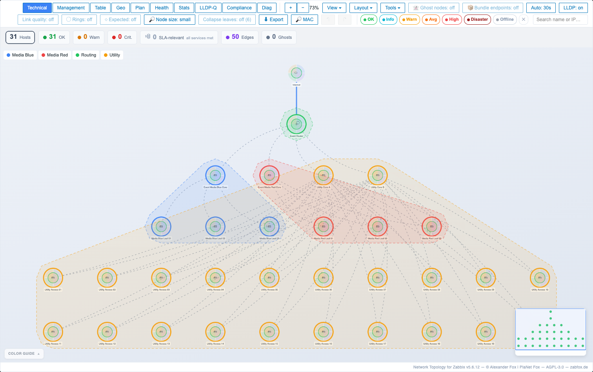
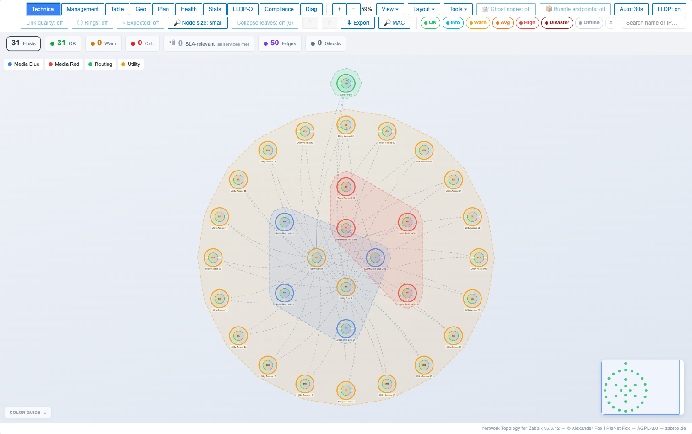
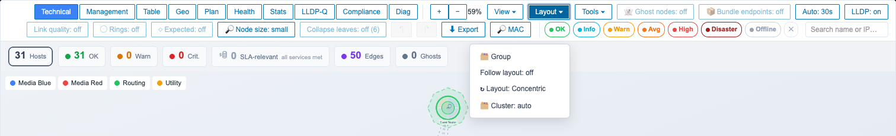

# Topology layouts for temporary event networks

Our fork of Network Topology for Zabbix includes layout changes for the temporary networks we build for live events. During setup, operators need to see which devices belong to each network, check the links as the crew patches the show, and keep a useful map open on a second screen. The same workflow starts again at the next event.

The screenshots use 31 synthetic hosts and 50 links in a local Zabbix 7.0 Docker lab. The fixture includes Media Red, Media Blue, Utility and Routing groups. [Reproduce the lab setup](../tools/layout-lab/README.md).

## Use the same tags in Hierarchy and Concentric

Add an `nt:tier` tag to each device and choose **Technical → Layout → Hierarchy** or **Concentric**.

| Tag value | Hierarchy | Concentric |
| --- | --- | --- |
| `spine` or `core` | Core row | Centre |
| `leaf` or `distribution` | Distribution row | First ring |
| `access` | Access row | Second ring |
| `endpoint` | Endpoint row | Outer tier |

With **Cluster Auto**, tagged devices across the selected host groups share one layout. Dashed boundaries, translucent fills, device rings and the legend identify each group. In a tagged Concentric view, untagged devices sit beyond the access tier. With no tier tags, Concentric arranges devices by their number of links.

## Group views and fullscreen controls

- **Rows** and **Columns** give each host group its own space. **Colours only** adds the rings and legend to the current layout. A device with uplinks into multiple groups can appear in a shared area with its links intact.
- **Follow layout** lets a second browser tab follow the saved device positions for the selected map while keeping its own pan and zoom. It is useful for a display or kiosk. Turn it off in the tab where you want to select a layout and keep the generated positions.
- Fullscreen menus and controls remain clickable when the toolbar wraps. The zoom readout reflects the current view. Returning to **Technical** from Table or Management restores the selected layout, outlines and fills while fullscreen stays active.

## Fork baseline and verification

The fork retains its prepared history reader and shared rebuild handling. It also incorporates the upstream v5.6.12 visibility check for stale snapshots and retries a snapshot request when that check cannot confirm visibility. These changes build on the cold rebuild work discussed in [upstream issue #35](https://github.com/linuser/zabbix-network-topology/issues/35).

Chrome checks verified group colours, fills, ring positions and fullscreen tab switches in the Docker lab. The production smoke test repeated the Concentric and Cluster Auto check on two role-tagged switch groups, including **Technical → Table → Technical** and **Technical → Management → Technical** while fullscreen stayed active. [Compare the deployed implementation](https://github.com/rhysjoseph/zabbix-network-topology/compare/c744703...26bec7e).
